# paperless-jev

[English](README.md) · **Deutsch**

Klassifiziert neue Dokumente im [Paperless-ngx](https://docs.paperless-ngx.com/)-Posteingang mit
[TypeSafe Jev](https://docs.typesafe.ai/introduction): Dokumenttyp, Korrespondent, Speicherpfad,
Ausstellungsdatum und Tags – oder lokal mit [clef](https://ollama.com/library/clef) über Ollama. Läuft als Docker-Container und wird komplett über eine Web-UI eingerichtet.

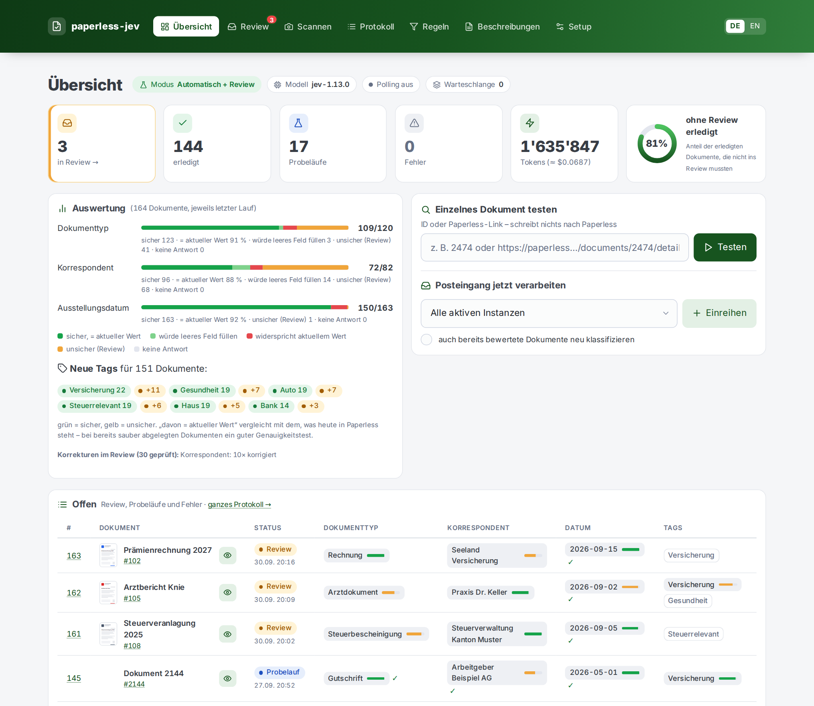

| Review (Desktop) | Dark Mode |
|---|---|
| 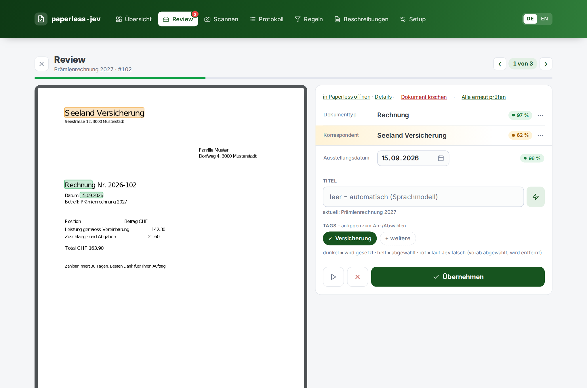 | 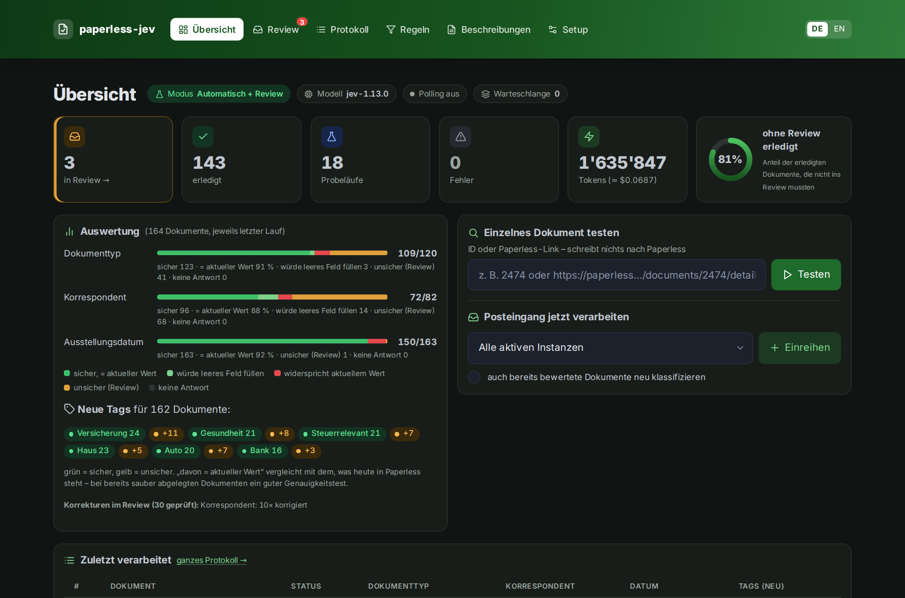 |

| Tags als Baum mit Umbau-Hilfe | Lösch-Assistent (Handy) |
|---|---|
| 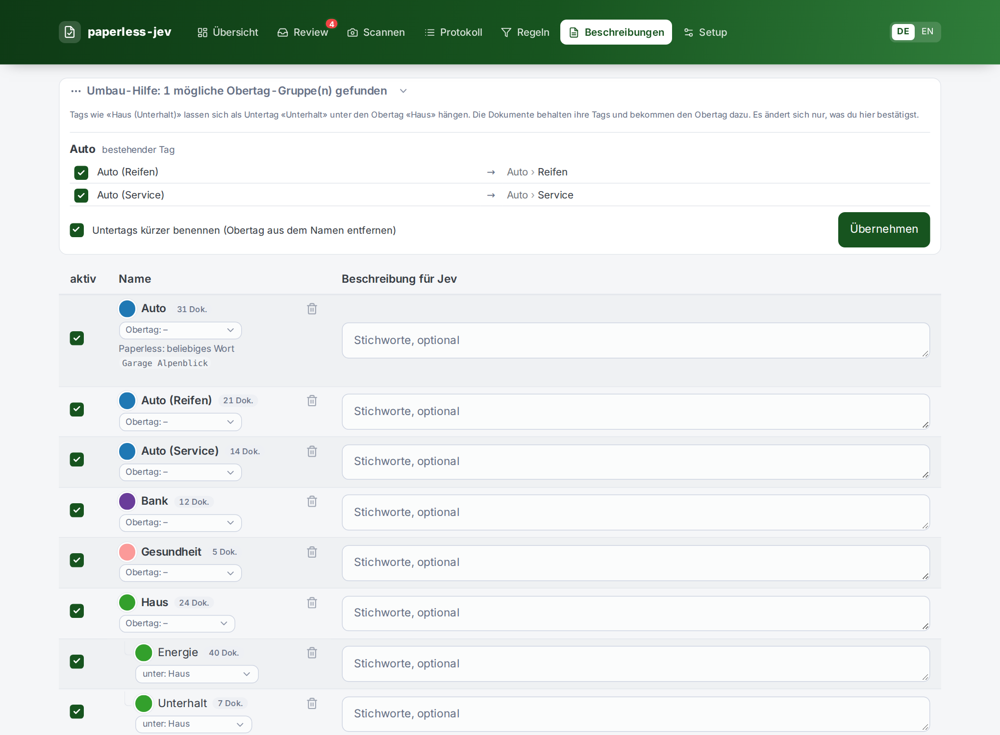 | 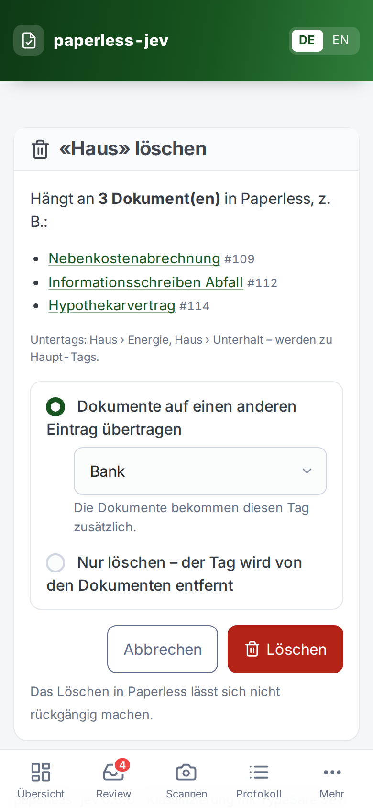 |

| Review (Handy) | Scannen (Handy) | Protokoll (Handy) | Beschreibungen (Handy) |
|---|---|---|---|
| 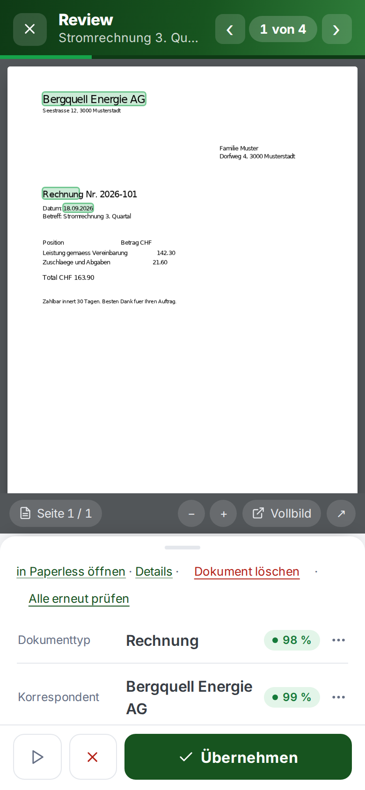 | 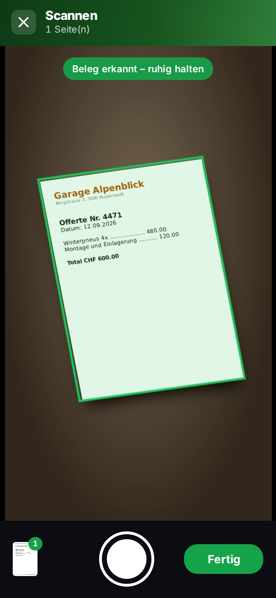 | 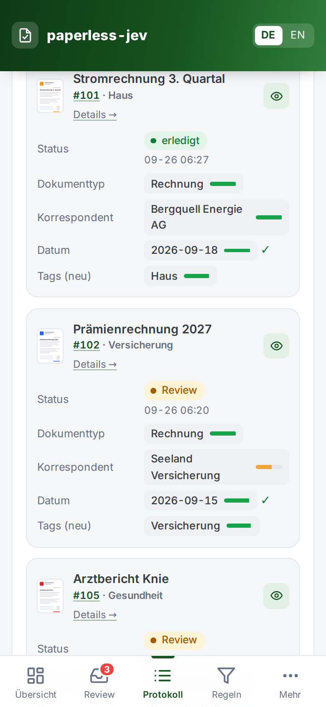 | 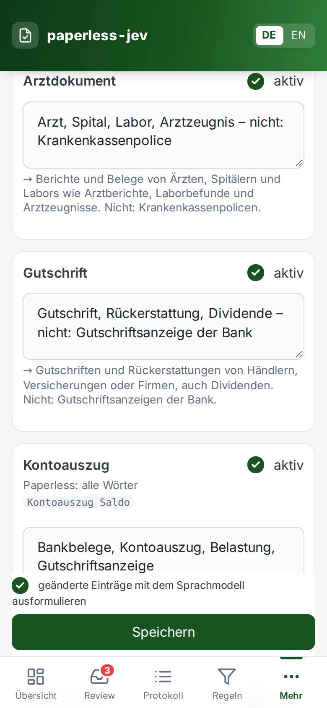 |

<sub>Screenshots mit erfundenen Demodaten, siehe [`demo/`](demo/).</sub>

## Funktionen

- **Klassifizierung mit Confidence** – Jev wählt aus deinen vorhandenen Paperless-Stammdaten und liefert
  zu jeder Antwort eine kalibrierte Sicherheit. Sichere Werte werden gesetzt, unsichere landen im Review.
- **Drei Modi** – *Probelauf* (nur protokollieren), *Nur Vorschläge* (alles ins Review) und
  *Automatisch* (sichere Werte setzen, Rest ins Review).
- **Review** Dokument für Dokument: PDF direkt im Review mit markierten Jev-Werten, Korrektur per Antippen,
  fürs Handy gemacht. Alle erneut prüfen nach Änderungen an der Konfiguration, Dokument löschen (Papierkorb).
- **Gegenprüfung** – Jev prüft auch schon gesetzte Tags und Werte. Widersprüche kommen ins Review oder werden
  ab einer einstellbaren Sicherheit direkt korrigiert.
  Unter Beschreibungen deaktivierte Tags werden auf Dokumenten zum Entfernen vorgeschlagen («ausmisten»).
- **Einzeltest** – ein Dokument per ID oder Paperless-Link prüfen, ohne etwas zu schreiben.
- **Neu prüfen per Tag** – alle Dokumente mit einem Tag erneut durch Jev, auch bereits abgelegte; standardmässig
  als Probelauf, bestehende Titel bleiben.
- **Lokal statt Cloud** – optional ein lokales Entscheidungsmodell über Ollama statt Jev, z. B.
  [clef](https://ollama.com/library/clef) von Cloudflare (siehe unten).
- **Auswertung** auf der Übersicht: Trefferquote je Feld im Vergleich zur heutigen Ablage.
- **Beschreibungen aus Stichworten** – ein lokales Sprachmodell (Ollama oder OpenAI-kompatibel,
  z. B. Qwen) formuliert deine Stichworte in der Sprache der Oberfläche aus (Deutsch oder Englisch, bei allen anderen Sprachen Englisch).
- **Belege scannen** mit dem Handy: Rand wird automatisch erkannt und entzerrt, mehrere Seiten zu einem PDF,
  direkt nach Paperless (siehe unten).
- **Titel** optional per Sprachmodell (Stil nach bereits abgelegten Dokumenten, eigene Anweisungen und Sprache wählbar, geprüft und bei Bedarf gekürzt)
  oder per Vorlage – entsteht schon bei der Analyse und ist im Review vorausgefüllt.
- **Neue Korrespondenten** – optional: Erkennt Jev keinen der vorhandenen, liest das Sprachmodell den Absender aus dem
  Dokument, und Jev prüft diesen Namen gegen die vorhandenen. Hält er stand, steht er als Vorschlag im Review –
  angelegt wird er in Paperless erst beim Übernehmen.
- **Stammdaten pflegen** ohne Paperless zu öffnen: Dokumenttypen, Korrespondenten und Tags anlegen (auch direkt im
  Review), Tag-Farben, Löschen mit Assistent – Dokumente auf einen anderen Eintrag übertragen oder nur entfernen.
- **Ablage-Konventionen** – Titel bereits abgelegter Dokumente gehen als Beispiele an Jev.
- **Ober-/Untertags** aus Paperless als Baum: Untertags mit Pfad («Haus › Unterhalt»), Jev bekommt den Obertag als
  Kontext, der Obertag wird automatisch mitgesetzt. Umbau-Hilfe hängt Tags wie «Haus (Unterhalt)» auf Wunsch unter «Haus».
- **Protokoll** mit Filtern nach Dokumenttyp, Korrespondent und Tag, standardmässig nur Offenes, bereinigen.
- **Webhook und Polling**, mehrere Paperless-Instanzen, Paperless-ngx 2.x und 3.x.
- **Oberfläche** auf Englisch, Deutsch, Französisch, Niederländisch, Spanisch, Italienisch und Polnisch (folgt der
  Browsersprache, sonst Englisch), fürs Handy optimiert, Dark Mode automatisch.

## Belege mit dem Handy scannen

Paperless hat keinen eigenen Handy-Scanner – paperless-jev bringt einen mit. Unter **Scannen** fotografierst du
Belege direkt im Browser, auch mehrseitige:

| ① Fotografieren | ② Rand prüfen | ③ Seiten &amp; hochladen | ④ Status |
|---|---|---|---|
|  | 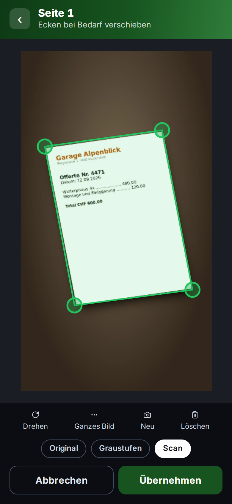 | 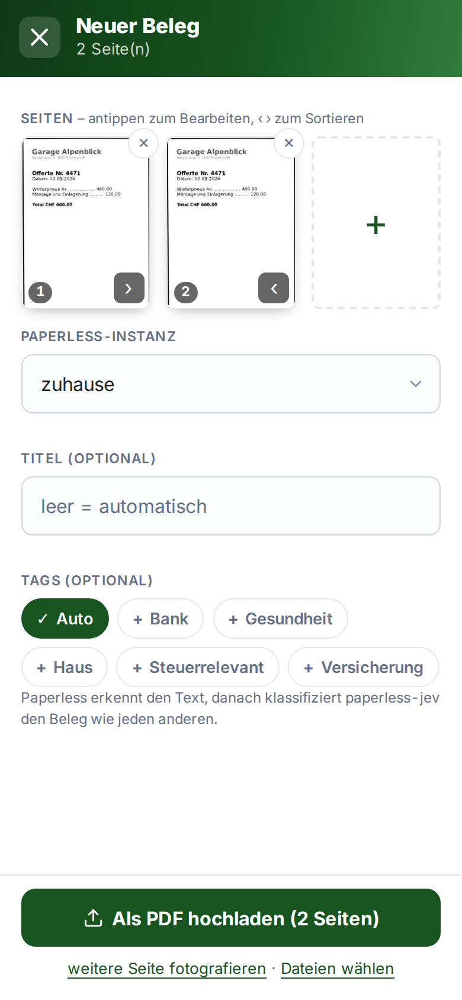 | 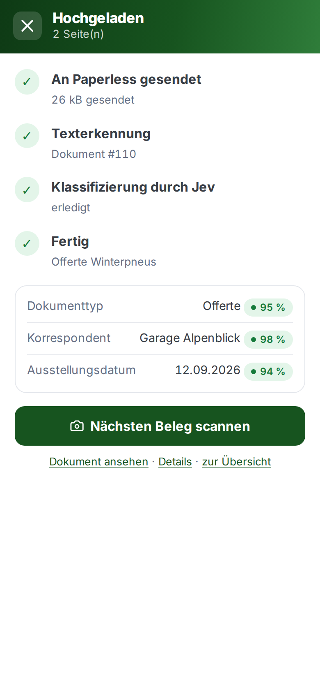 |

1. **Fotografieren** – der Beleg wird live erkannt (grüner Rahmen), Seite für Seite aufnehmen.
2. **Rand prüfen** – die Seite wird perspektivisch gerade gerückt; Ecken bei Bedarf verschieben, drehen,
   Filter *Original*, *Graustufen* oder *Scan* (Schatten ausgeglichen, kontrastreich für die Texterkennung).
3. **Hochladen** – Seiten sortieren, Instanz, optional Titel und Tags; alle Seiten gehen als **ein PDF** an Paperless.
   Fertige PDFs (z. B. iOS «Dokumente scannen») lassen sich ebenfalls hochladen.
4. **Status** – Texterkennung in Paperless, danach klassifiziert paperless-jev sofort; das Ergebnis erscheint direkt.

Voraussetzungen: Die Seite läuft über **HTTPS** (Kamera im Browser), und ein `Permissions-Policy`-Header des
Reverse Proxys sperrt die Kamera nicht (`camera=(self)`). Die Randerkennung (OpenCV.js, ~10 MB) wird beim ersten
Kamerastart geladen und danach aus dem Cache verwendet.

## So funktioniert es

```
Paperless-ngx ──Webhook "Dokument hinzugefügt"──▶ paperless-jev ──▶ TypeSafe Jev
      ▲                  (oder Polling)               │
      └──────────── REST: Dokument lesen, Werte setzen ┘
```

Jev erzeugt keinen Text, es **wählt aus**: aus deinen Stammdaten bzw. aus Datumsangaben, die der Code
vorher im OCR-Text gefunden hat. Pro Dokument geht **eine** Anfrage mit allen Fragen an Jev; nur wenn ein
neuer Korrespondent zu prüfen ist, kommt eine zweite, kleine dazu.

| Confidence | Aktion (Modus *Automatisch*) |
|---|---|
| ≥ Auto-Schwelle | Wert wird direkt in Paperless gesetzt |
| ≥ Review-Schwelle | Vorschlag in der Review-Queue (Tag `ai-review`) |
| darunter | ignoriert |

## Schnellstart

Fertiges Image (amd64 und arm64):

```bash
docker run -d --name paperless-jev -p 8090:8000 -v paperless-jev-data:/data \
  -e PJ_ADMIN_PASSWORD='passwort-waehlen' \
  ghcr.io/pendraga/paperless-jev:latest
# → http://localhost:8090
```

Oder selbst bauen:

```bash
git clone https://github.com/PenDraga/paperless-jev.git
cd paperless-jev
cp .env.example .env   # PJ_ADMIN_PASSWORD setzen
docker compose up -d --build
```

1. **Einstellungen → Verbindungen** – TypeSafe-API-Key eintragen, Paperless-Instanz mit URL und API-Token anlegen, „Verbindung testen“.
2. **Einstellungen → Regeln** – im Modus *Probelauf* starten, Felder und Schwellwerte wählen. Ein Sprachmodell für Titel, Beschreibungen und neue Korrespondenten ist optional und wird unter *Verbindungen* eingerichtet.
3. **Einstellungen → Beschreibungen** – für Dokumenttypen und Tags ein paar Stichworte hinterlegen, vor allem zur Abgrenzung
   ähnlicher Kategorien („… – nicht: …“).
4. **Übersicht → Posteingang jetzt verarbeiten** und im Protokoll prüfen, wie gut die Vorschläge sind.
5. Danach Modus *Automatisch* aktivieren und in Paperless den Webhook anlegen (siehe unten).

### Umgebungsvariablen

Alles Fachliche wird in der Web-UI eingestellt. Per Umgebung gibt es nur:

| Variable | Standard | Zweck |
|---|---|---|
| `PJ_SECRET_KEY` | – | Schlüssel für die Verschlüsselung der gespeicherten Tokens. Ohne Angabe wird `/data/secret.key` erzeugt. |
| `PJ_ADMIN_USER` / `PJ_ADMIN_PASSWORD` | `admin` / – | Anmeldung für die Web-UI: Anmeldeseite, die mit Passwort-Managern funktioniert, bleibt bei Nutzung 30 Tage angemeldet (höchstens 90 Tage ab Anmeldung), Abmelde-Knopf, der auch Kopien der Sitzung beendet. `/hook/*` und `/health` bleiben offen; ein Basic-Auth-Header wird für Skripte weiter akzeptiert. **Ohne Passwort ist die Web-UI gesperrt** (HTTP 503), ausser `PJ_ALLOW_NO_LOGIN` ist gesetzt. |
| `PJ_ALLOW_NO_LOGIN` | `false` | `true` öffnet die Web-UI ohne Passwort. Nur, wenn ein vorgeschalteter Login (z. B. Authentik) jede Anfrage schützt und der Container anders nicht erreichbar ist. |
| `PJ_TRUSTED_PROXIES` | `127.0.0.1` | Adressen oder Netze (kommagetrennt, z. B. `172.19.0.0/16`), die `X-Forwarded-For`/`-Proto` setzen dürfen. Hinter einem Reverse Proxy dessen Netz eintragen, sonst gilt die Sperre nach Fehlversuchen für den Proxy statt für den Client, und das Sitzungs-Cookie bekommt kein `Secure`. |
| `PJ_LOG_LANGUAGE` | `en` | Sprache der Log-Meldungen und der Fehlerantworten des Webhooks (`en`, `de`, `es`, `fr`, `it`, `nl`, `pl`). Gilt für die ganze Installation; die Sprache der Web-UI wählt jeder Browser selbst. Antworten von Paperless oder vom Sprachmodell und Python-Tracebacks bleiben unverändert. |
| `PJ_LOG_LEVEL` | `INFO` | Log-Level |
| `PJ_DATA_DIR` | `/data` | Datenverzeichnis (SQLite, Schlüssel) |
| `CLOUDFLARE_ACCOUNT_ID` / `CLOUDFLARE_API_TOKEN_FILE` | – | Optional für Cloudflare Workers AI, wenn die Felder unter Verbindungen leer sind; das Token wird aus einer Datei gelesen, z. B. einem Docker-Secret |
| `TZ` | `Europe/Zurich` | Zeitzone für die Anzeige |

**`/data` sichern** – `paperless-jev.db` und `secret.key` gehören zusammen, sonst sind die gespeicherten Tokens nicht mehr lesbar.

### Betrieb hinter Traefik

Beispiel: [`deploy/compose.yaml`](deploy/compose.yaml) – im selben Netz wie Paperless, Web-UI nur aus dem
internen Netz (IP-Allowlist). Wichtig: Eine Header-Middleware mit `frameDeny: true`
(`X-Frame-Options: DENY`) blockiert den Dokument-Viewer. paperless-jev setzt selbst
`X-Frame-Options: SAMEORIGIN`, eine Middleware ohne `frameDeny` genügt also. `PJ_TRUSTED_PROXIES` auf das Traefik-Netz setzen. Fürs Scannen darf ein `Permissions-Policy`-Header die Kamera nicht sperren (`camera=(self)` statt `camera=()`), und die Seite muss über HTTPS laufen.

### Webhook in Paperless

Paperless (≥ 2.14) → *Workflows* → neuer Workflow:

- Auslöser *Dokument hinzugefügt*
- Aktion *Webhook*: `http://paperless-jev:8000/hook/<instanzname>?token=<secret>` (Secret unter Einstellungen → Verbindungen),
  *Webhook-Parameter verwenden* aktiv, Parameter `doc_id` = `{{ doc_id }}`

Polling (Standard alle 5 Minuten) bleibt als Fallback aktiv und verarbeitet nur Dokumente im Posteingang,
die noch nie bewertet wurden.

### Übergabe von einem anderen Werkzeug

Soll ein anderes Werkzeug zuerst fertig werden (z. B. paperless-gpt für OCR und Titel), lässt man es einen Tag
wie `jev-pending` setzen und trägt diesen unter *Einstellungen → Regeln → Tags für den Status* als *Warteschlangen-Tag* ein. Jev nimmt
dann nur Dokumente mit diesem Tag – per Polling und per Webhook – und entfernt ihn danach. Die eigenen Tags des
anderen Werkzeugs gehören unter *System-Tags*, damit Jev sie nie vorschlägt oder prüft.

## Jev über Cloudflare Workers AI

Cloudflare bietet dasselbe Jev-Modell als `typesafe/jev` an, zum gleichen Preis, abgerechnet über das eigene
Cloudflare-Konto. Unter *Einstellungen → Verbindungen → Klassifizierung → Cloudflare Workers AI* Konto-ID und ein API-Token mit
Workers-AI-Berechtigung eintragen. Jev ist ein Partnermodell: Es braucht vorausbezahltes Guthaben im **AI Gateway**
von Cloudflare (das Gratis-Kontingent von Workers AI gilt dafür nicht). Cloudflare wählt die Jev-Version; anders als
bei TypeSafe lässt sie sich nicht pinnen, eine neue Version kann die Confidence-Werte verschieben. Im Blindtest mit
30 abgelegten Dokumenten lieferten beide Wege identische Antworten (Confidence im Mittel 0.01 auseinander).

Im selben Formular lassen sich als Modell auch Cloudflares eigene Entscheidungsmodelle `@cf/cloudflare/clef` (27B)
und `@cf/cloudflare/clef-flash` (9B) wählen. Sie laufen über die normale Workers-AI-Abrechnung (0.24 bzw. 0.038 USD
pro Mio. Input-Tokens) und brauchen kein Guthaben im AI Gateway. Clef wird wie das lokale clef behandelt: eigene
Schwellwerte unter Regeln und einfache Kriterien ohne Beispiel-Titel und ähnliche Dokumente.

## Lokale Klassifizierung mit Ollama (clef)

Statt TypeSafe Jev kann ein lokales Entscheidungsmodell klassifizieren, das den Endpunkt `/v1/systemone` von
Ollama unterstützt (Fähigkeit «decision»), z. B. [clef](https://ollama.com/library/clef) von Cloudflare (27B,
Apache 2.0, ~18 GB). Einrichten unter *Einstellungen → Verbindungen → Klassifizierung → Lokal über Ollama* mit URL und Modell.
Dokumente verlassen dann das eigene Netz nicht.
Nimmt der Server das System-One-Format unter einem anderen Pfad an, dort den Endpunkt ändern (Vorgabe `/v1/systemone`).
Verlangt der Server eine Anmeldung, einen API-Key eintragen; er wird als Bearer-Token gesendet.

paperless-jev berücksichtigt die Grenzen von clef automatisch: höchstens 64 Fragen pro Anfrage (wird aufgeteilt)
und 26 Kandidaten pro Auswahlfrage (bei mehr Korrespondenten oder Typen ein Turnier: Gruppen bewerten, Finale mit
den besten) – das Turnier nur, wenn der Server zu viele Kandidaten ablehnt; Server wie Decision-1.0-Lux (bis 255)
werden direkt gefragt. Lokale Modelle bekommen einfache Kriterien ohne Beispiel-Titel und eigene Schwellwerte.

| Vergleich | Jev | clef |
|---|---|---|
| 32 erfundene Dokumente (`bench/`): Typ / Korrespondent / Datum | 29 / 31 / 30 von 32 | 30 / 31 / 31 von 32 |
| 43 echte, im Review geprüfte Dokumente: Typ / Korrespondent / Datum | 43 / 43 / 33 | 38 / 38 / 32 |
| Neue Tags bei echten Dokumenten | brauchbar | unzuverlässig |
| [Decision-1.0-Lux-9B](https://huggingface.co/vllm-sr/Decision-1.0-Lux-9B) bei denselben 43 | – | Typ 41–42, Korrespondent 37, Datum 32; sauberer kalibriert, mehr automatisch gesetzt; neue Tags ebenfalls unzuverlässig |
| Zeit pro Dokument | unter 1 s | 5–25 s (GPU) |

Mit einfachen, erfundenen Belegen ist clef gleichauf; bei echten Dokumenten mit vielen Tags liegt Jev klar vorne.
Eigene Messung: `python -m bench.run --jev --ollama http://<host>:11434` (siehe [`bench/`](bench/)).

## Datenschutz und Kosten

- Der gekürzte OCR-Text und die Namen deiner Stammdaten gehen an `api.typesafe.ai`. TypeSafe trainiert laut
  Doku nicht auf Kundendaten. Dokumente mit dem Tag `ai-ignorieren` werden nie gesendet.
- Mit Cloudflare Workers AI gehen dieselben Daten stattdessen an Cloudflare (laut Cloudflare ohne Speicherung).
- Mit einem lokalen Modell über Ollama (z. B. clef) bleibt alles im eigenen Netz.
- Das optionale Sprachmodell läuft bei dir (Ollama, SGLang, vLLM, LM Studio …). Für Titel und neue Korrespondenten
  bekommt es einen Auszug des Dokumenttexts.
- Jev kostet 0.042 USD pro Mio. Input-Tokens (jev-1.13 und jev-1.14). Ein Dokument liegt je nach Anzahl Tags und Beispielen
  bei grob 5–15k Tokens, also unter 0.001 USD. Die Übersicht zeigt die Summe.

## Probelauf auf der Kommandozeile

Schreibt nichts nach Paperless und zeigt pro Dokument Vorschlag, Confidence und aktuellen Wert:

```bash
docker run --rm -it --network <paperless-netz> \
  -e PAPERLESS_URL=http://paperless:8000 -e PAPERLESS_TOKEN=... -e TYPESAFE_API_KEY=... \
  paperless-jev:latest paperless-jev-spike --sample 50 --blind
```

Mit `--cloudflare` (und `CLOUDFLARE_ACCOUNT_ID`, `CLOUDFLARE_API_TOKEN_FILE`) läuft Jev über Cloudflare Workers AI.

`--blind` blendet die heutige Ablage aus und vergleicht die Vorschläge damit. Beschreibungen lassen sich
vorab mit `--descriptions` testen, Vorlage: [`beschreibungen.beispiel.json`](beschreibungen.beispiel.json).

## Entwicklung

```bash
pip install -e '.[dev]'
pytest
PJ_DATA_DIR=./data paperless-jev
```

Architektur, Designentscheidungen und Messungen: [DOKUMENTATION.md](DOKUMENTATION.md).

## Mitwirken

Ideen, Wünsche und Fehlermeldungen sind willkommen – bitte als
[Issue](https://github.com/PenDraga/paperless-jev/issues) erfassen. Pull Requests sind ebenfalls willkommen: gegen
`main`, einer pro Thema. Übernommen wird, was passt, in der Regel neu geschrieben im Stil des Projekts und mit dir als
Mitautor – ein Pull Request wird deshalb oft mit Verweis auf den Commit geschlossen statt gemergt.

## Lizenz

Copyright (C) 2026 PenDraga. Lizenziert unter der [GNU Affero General Public License v3.0](LICENSE) oder neuer,
ab Version 0.4.1 (Versionen bis 0.4.0 erschienen unter MIT).

Kurz: paperless-jev darf frei genutzt, verändert und weitergegeben werden – auch zu Hause für die Familie. Wer eine
veränderte Fassung anderen zugänglich macht, auch als Webdienst, muss deren Quellcode unter derselben Lizenz veröffentlichen.
