# paperless-jev

**English** · [Deutsch](README.de.md)

Classifies new documents in the [Paperless-ngx](https://docs.paperless-ngx.com/) inbox with
[TypeSafe Jev](https://docs.typesafe.ai/introduction): document type, correspondent, storage path,
issue date and tags – or locally with [clef](https://ollama.com/library/clef) via Ollama. Runs as a Docker container and is configured entirely through a web UI.

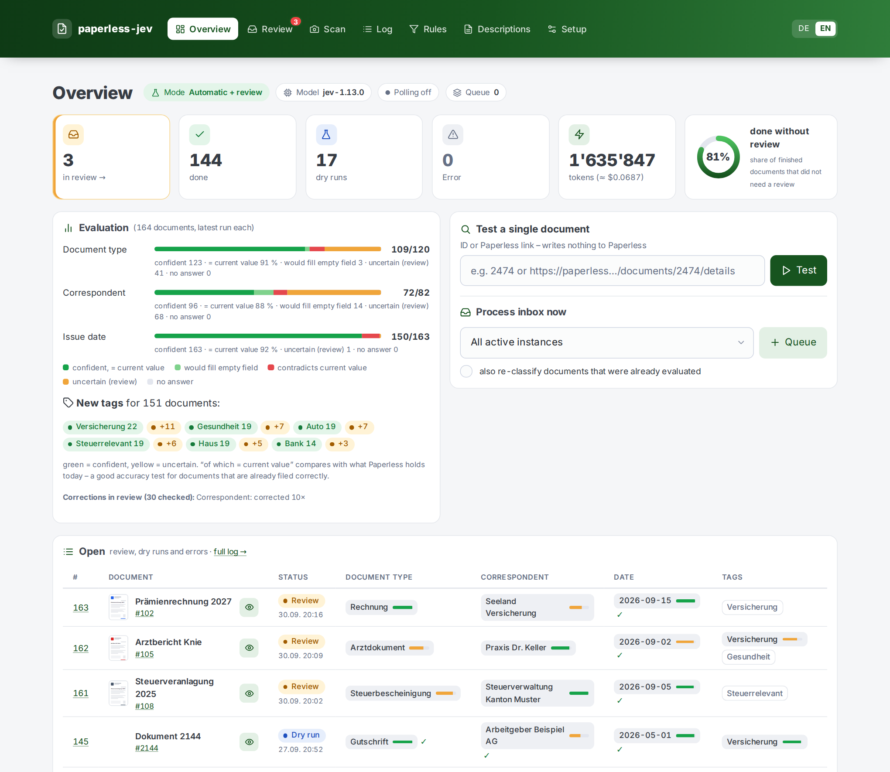

| Review (desktop) | Dark mode |
|---|---|
| 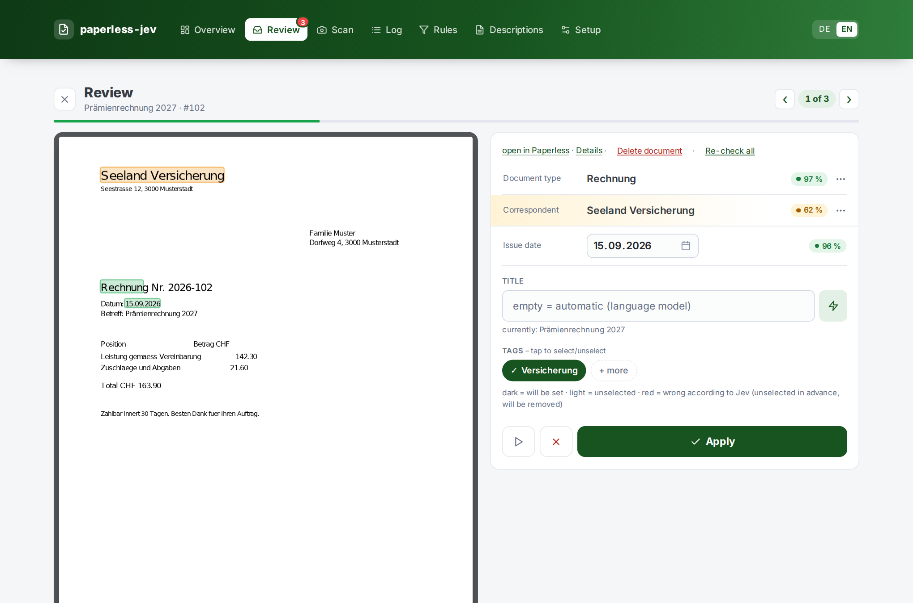 | 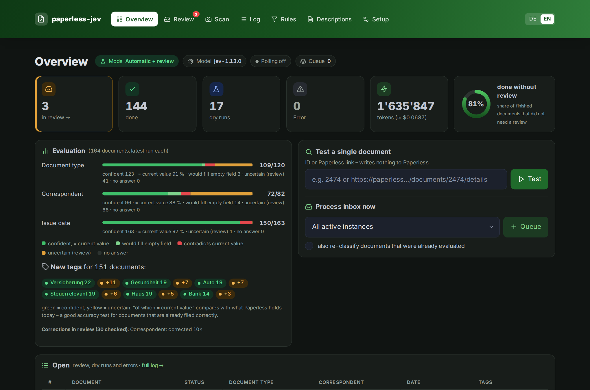 |

| Tags as a tree with restructuring helper | Delete assistant (phone) |
|---|---|
| 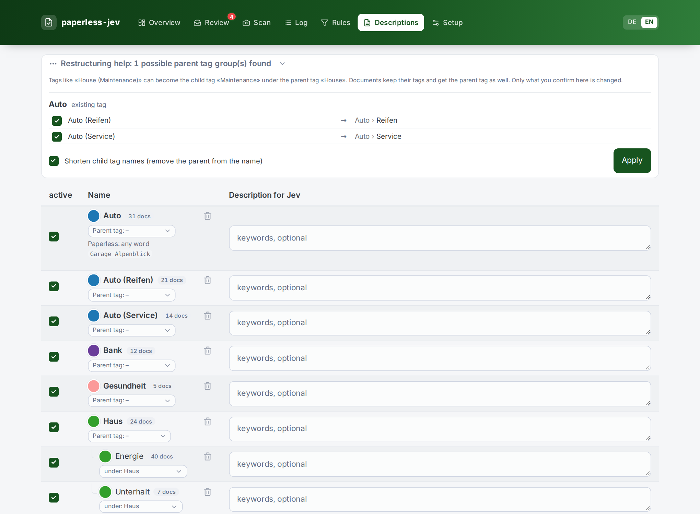 | 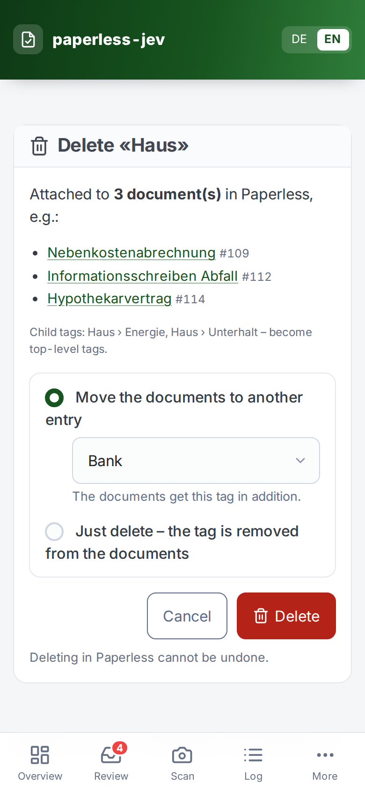 |

| Review (phone) | Scan (phone) | Log (phone) | Descriptions (phone) |
|---|---|---|---|
| 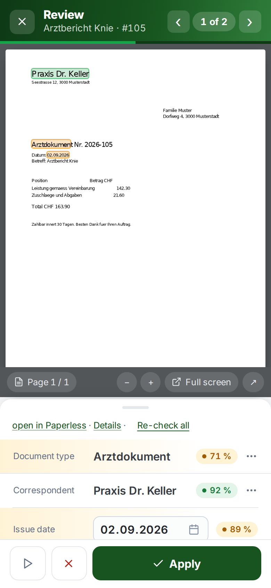 | 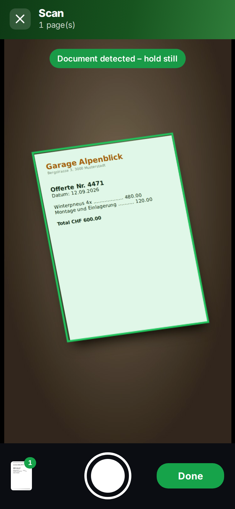 | 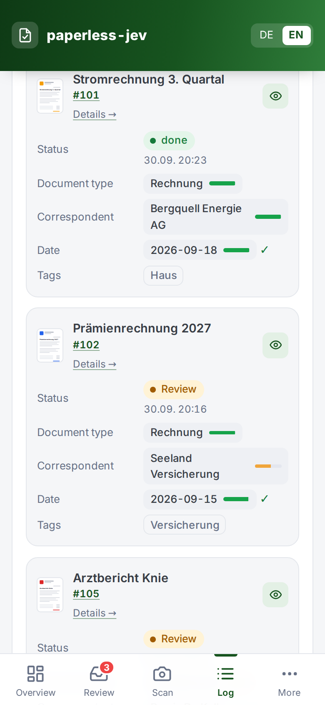 | 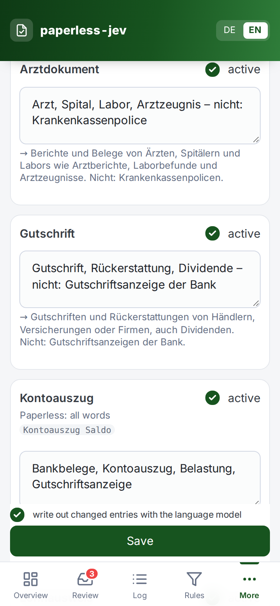 |

<sub>Screenshots with made-up demo data, see [`demo/`](demo/).</sub>

## Features

- **Classification with confidence** – Jev chooses from your existing Paperless metadata and returns a
  calibrated confidence for every answer. Confident values are applied, uncertain ones go to review.
- **Three modes** – *dry run* (log only), *suggestions only* (everything to review) and
  *automatic* (apply confident values, the rest to review).
- **Review** one document at a time: the PDF right in the review with Jev's values highlighted, corrections with
  a tap, built for phones. Re-check all after configuration changes, delete documents (trash).
- **Double-check** – Jev also checks tags and values that are already set. Contradictions go to review or are
  corrected directly above a configurable confidence.
  Tags deactivated under Descriptions are suggested for removal from documents ("clean-up").
- **Single test** – check one document by ID or Paperless link without writing anything.
- **Re-check by tag** – run every document with a given tag through Jev again, including documents already filed;
  a dry run by default, existing titles are kept.
- **Local instead of cloud** – optionally a local decision model via Ollama instead of Jev, e.g.
  [clef](https://ollama.com/library/clef) by Cloudflare (see below).
- **Evaluation** on the overview: hit rate per field compared with your current filing.
- **Descriptions from keywords** – a local language model (Ollama or OpenAI-compatible, e.g. Qwen)
  turns your keywords into a full description in the interface language (German or English; English for all other languages).
- **Scan documents** with your phone: edges detected and straightened automatically, several pages into one PDF,
  straight to Paperless (see below).
- **Titles** optionally by language model (in the style of documents already filed, with your own instructions and language, checked and shortened if
  needed) or by template – created during analysis and pre-filled in review.
- **Manage metadata** without opening Paperless: create document types, correspondents and tags (also right in
  review), tag colours, delete with an assistant – move documents to another entry or just remove it.
- **Filing conventions** – titles of documents already filed are sent to Jev as examples.
- **Parent/child tags** from Paperless as a tree: child tags with their path ("House › Maintenance"), Jev gets the
  parent as context, the parent is set along automatically. A restructuring helper can move tags like "House (Maintenance)" under "House".
- **Log** with filters by document type, correspondent and tag, open entries by default, cleanup.
- **Webhook and polling**, multiple Paperless instances, Paperless-ngx 2.x and 3.x.
- **Interface** in English, German, French, Dutch, Spanish, Italian and Polish (follows the browser language, otherwise
  English), optimised for phones, automatic dark mode.

## Scan documents with your phone

Paperless has no phone scanner of its own – paperless-jev brings one. Under **Scan** you photograph documents
right in the browser, multi-page ones included:

| ① Photograph | ② Check edges | ③ Pages &amp; upload | ④ Status |
|---|---|---|---|
|  | 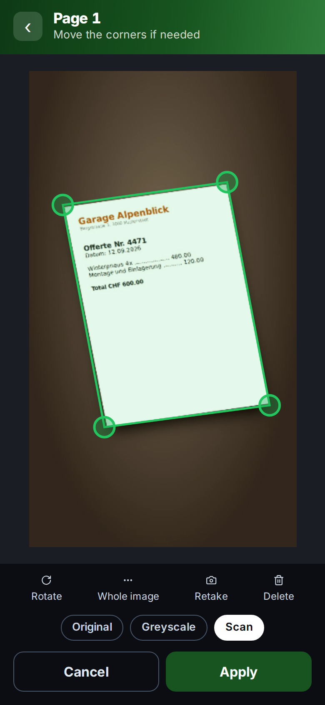 | 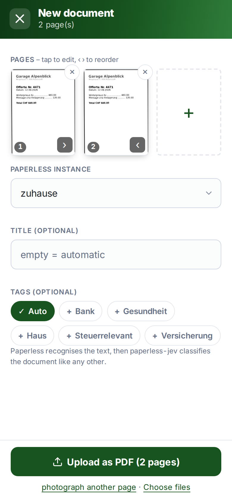 | 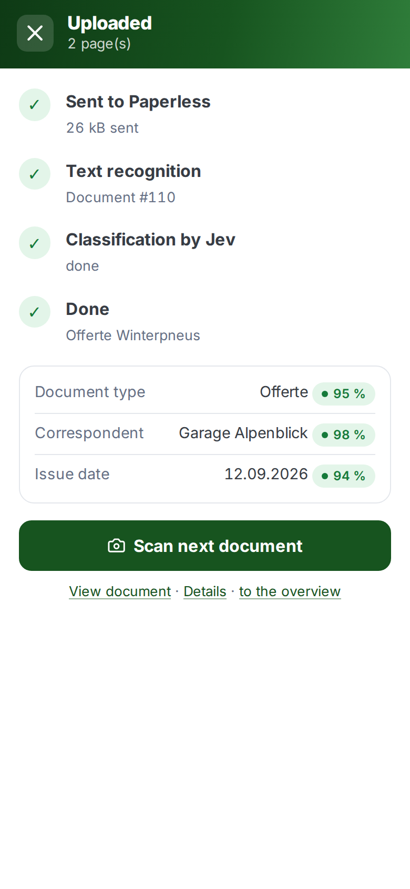 |

1. **Photograph** – the document is detected live (green frame); take one page after another.
2. **Check edges** – the page is straightened in perspective; move the corners if needed, rotate, choose the
   filter *Original*, *Greyscale* or *Scan* (shadows evened out, high contrast for text recognition).
3. **Upload** – reorder pages, pick the instance, optionally title and tags; all pages go to Paperless as **one PDF**.
   Ready-made PDFs (e.g. iOS "Scan Documents") can be uploaded too.
4. **Status** – text recognition in Paperless, then paperless-jev classifies right away; the result appears directly.

Requirements: the page is served over **HTTPS** (camera in the browser), and a `Permissions-Policy` header from the
reverse proxy does not block the camera (`camera=(self)`). Edge detection (OpenCV.js, ~10 MB) is loaded on the first
camera start and cached afterwards.

## How it works

```
Paperless-ngx ──webhook "document added"──▶ paperless-jev ──▶ TypeSafe Jev
      ▲              (or polling)               │
      └──────── REST: read document, set values ┘
```

Jev does not generate text, it **chooses**: from your metadata, or from dates that the code found in the
OCR text beforehand. Each document is sent to Jev as **one** request containing all questions.

| Confidence | Action (*automatic* mode) |
|---|---|
| ≥ auto threshold | value is set in Paperless directly |
| ≥ review threshold | suggestion in the review queue (tag `ai-review`) |
| below | ignored |

## Quick start

Ready-made image (amd64 and arm64):

```bash
docker run -d --name paperless-jev -p 8090:8000 -v paperless-jev-data:/data \
  -e PJ_ADMIN_PASSWORD='choose-a-password' \
  ghcr.io/pendraga/paperless-jev:latest
# → http://localhost:8090
```

Or build it yourself:

```bash
git clone https://github.com/PenDraga/paperless-jev.git
cd paperless-jev
cp .env.example .env   # set PJ_ADMIN_PASSWORD
docker compose up -d --build
```

1. **Settings → Connections** – enter your TypeSafe API key, add a Paperless instance with URL and API token, "Test connection".
2. **Settings → Rules** – start in *dry run* mode, choose fields and thresholds, optionally set up a language model.
3. **Settings → Descriptions** – add a few keywords for document types and tags, especially to separate similar
   categories ("… – not: …").
4. **Overview → Process inbox now** and check the log to see how good the suggestions are.
5. Then switch to *automatic* mode and create the webhook in Paperless (see below).

### Environment variables

Everything else is configured in the web UI. The environment only covers:

| Variable | Default | Purpose |
|---|---|---|
| `PJ_SECRET_KEY` | – | Key for encrypting stored tokens. If unset, `/data/secret.key` is created. |
| `PJ_ADMIN_USER` / `PJ_ADMIN_PASSWORD` | `admin` / – | Login for the web UI: sign-in page that works with password managers, stays signed in for 30 days of use (90 days at most after signing in), sign-out button that also ends copies of the session. `/hook/*` and `/health` stay open; a basic-auth header is still accepted for scripts. **Without a password the web UI is locked** (HTTP 503) unless `PJ_ALLOW_NO_LOGIN` is set. |
| `PJ_ALLOW_NO_LOGIN` | `false` | `true` opens the web UI without a password. Only for setups where a login in front of it (e.g. Authentik) protects every request and the container can't be reached any other way. |
| `PJ_TRUSTED_PROXIES` | `127.0.0.1` | Addresses or networks (comma-separated, e.g. `172.19.0.0/16`) allowed to set `X-Forwarded-For`/`-Proto`. Behind a reverse proxy, enter its network, otherwise the login lockout applies to the proxy instead of the client and the session cookie lacks the `Secure` flag. |
| `PJ_LOG_LEVEL` | `INFO` | Log level |
| `PJ_DATA_DIR` | `/data` | Data directory (SQLite, key) |
| `TZ` | `Europe/Zurich` | Time zone for display |
| `CLOUDFLARE_ACCOUNT_ID` / `CLOUDFLARE_API_TOKEN_FILE` | – | Optional for Cloudflare Workers AI when the fields under Connections are empty; the token is read from a file, e.g. a Docker secret |

**Back up `/data`** – `paperless-jev.db` and `secret.key` belong together, otherwise the stored tokens can no longer be read.

### Running behind Traefik

Example: [`deploy/compose.yaml`](deploy/compose.yaml) – in the same network as Paperless, web UI reachable
from the internal network only (IP allowlist). Note: a headers middleware with `frameDeny: true`
(`X-Frame-Options: DENY`) blocks the document viewer. paperless-jev sends
`X-Frame-Options: SAMEORIGIN` itself, so a middleware without `frameDeny` is enough. Set `PJ_TRUSTED_PROXIES` to the Traefik network. For scanning, a `Permissions-Policy` header must not block the camera (`camera=(self)` instead of `camera=()`), and the page must be served over HTTPS.

### Webhook in Paperless

Paperless (≥ 2.14) → *Workflows* → new workflow:

- Trigger *Document added*
- Action *Webhook*: `http://paperless-jev:8000/hook/<instance name>?token=<secret>` (secret under Settings → Connections),
  *Use webhook parameters* enabled, parameter `doc_id` = `{{ doc_id }}`

Polling (every 5 minutes by default) stays active as a fallback and only processes inbox documents that
have never been evaluated.

### Handing off from another tool

To let another tool (e.g. paperless-gpt for OCR and titles) finish first, have it add a tag such as
`jev-pending` and enter that as the *queue tag* under *Settings → Rules → Status tags*. Jev then only takes documents
with that tag – by polling and by webhook – and removes it afterwards. List the other tool's own tags under
*system tags* so Jev never suggests or checks them.

## Jev via Cloudflare Workers AI

Cloudflare serves the same Jev model as `typesafe/jev`, at the same price, billed to your Cloudflare account.
Choose *Settings → Connections → Classification → Cloudflare Workers AI* and enter the account ID and an API token with Workers AI
permission. Jev is a partner model: it needs prepaid credits in Cloudflare's **AI Gateway** (the free Workers AI
allowance does not cover it). Cloudflare picks the Jev version; unlike TypeSafe it cannot be pinned, so a new
version can shift the confidence values. In a blind test on 30 filed documents both routes gave identical answers
(confidence on average 0.01 apart).

## Local classification with Ollama (clef)

Instead of TypeSafe Jev, a local decision model that supports Ollama's `/v1/systemone` endpoint (capability
"decision") can classify, e.g. [clef](https://ollama.com/library/clef) by Cloudflare (27B, Apache 2.0, ~18 GB).
Set it up under *Settings → Connections → Classification → Local via Ollama* with URL and model. Documents then never leave your network.
If the server requires authentication, enter an API key; it is sent as a bearer token.

paperless-jev handles clef's limits automatically: at most 64 questions per request (split up) and 26 candidates per
choice question (with more correspondents or types, a tournament: rate groups, final round with the best) – only if
the server rejects too many candidates; servers like Decision-1.0-Lux (up to 255) are asked directly. Local
models get plain criteria without example titles and their own thresholds.

| Comparison | Jev | clef |
|---|---|---|
| 32 made-up documents (`bench/`): type / correspondent / date | 29 / 31 / 30 of 32 | 30 / 31 / 31 of 32 |
| 43 real documents checked in review: type / correspondent / date | 43 / 43 / 33 | 38 / 38 / 32 |
| New tags on real documents | usable | unreliable |
| [Decision-1.0-Lux-9B](https://huggingface.co/vllm-sr/Decision-1.0-Lux-9B) on the same 43 | – | type 41–42, correspondent 37, date 32; better calibrated, more auto-set values; new tags unreliable too |
| Time per document | under 1 s | 5–25 s (GPU) |

On simple made-up documents clef is on par; on real documents with many tags Jev is clearly ahead.
Run your own: `python -m bench.run --jev --ollama http://<host>:11434` (see [`bench/`](bench/)).

## Privacy and cost

- The shortened OCR text and the names of your metadata are sent to `api.typesafe.ai`. According to its
  documentation, TypeSafe does not train on customer data. Documents tagged `ai-ignorieren` are never sent.
- With Cloudflare Workers AI the same data goes to Cloudflare instead (zero data retention according to Cloudflare).
- With a local model via Ollama (e.g. clef) everything stays in your own network.
- The optional language model runs on your own hardware (Ollama, SGLang, vLLM, LM Studio …).
- jev-1.13 costs USD 0.042 per million input tokens. A document takes roughly 5–15k tokens, depending on
  the number of tags and examples, i.e. less than USD 0.001. The overview shows the total.

## Command-line dry run

Writes nothing to Paperless and shows suggestion, confidence and current value per document:

```bash
docker run --rm -it --network <paperless network> \
  -e PAPERLESS_URL=http://paperless:8000 -e PAPERLESS_TOKEN=... -e TYPESAFE_API_KEY=... \
  paperless-jev:latest paperless-jev-spike --sample 50 --blind
```

With `--cloudflare` (and `CLOUDFLARE_ACCOUNT_ID`, `CLOUDFLARE_API_TOKEN_FILE`) Jev runs via Cloudflare Workers AI.

`--blind` hides the current filing and compares the suggestions with it. Descriptions can be tested
beforehand with `--descriptions`, template: [`beschreibungen.beispiel.json`](beschreibungen.beispiel.json).

## Development

```bash
pip install -e '.[dev]'
pytest
PJ_DATA_DIR=./data paperless-jev
```

Architecture, design decisions and measurements: [DOCUMENTATION.md](DOCUMENTATION.md).

## Contributing

Ideas, wishes and bug reports are welcome – please open an
[issue](https://github.com/PenDraga/paperless-jev/issues). Pull requests are not accepted for now.

## License

Copyright (C) 2026 PenDraga. Licensed under the [GNU Affero General Public License v3.0](LICENSE) or later,
from version 0.4.1 on (versions up to 0.4.0 were released under MIT).

In short: you may use, change and share paperless-jev freely – including at home for your family. If you make a
modified version available to others, also as a web service, you must publish its source code under the same license.
